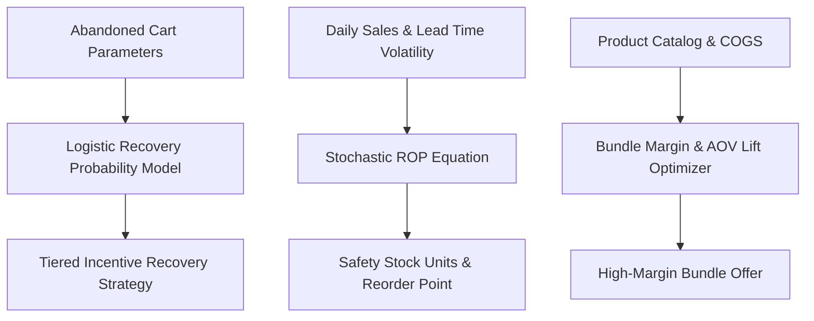

# genpark-accio-shopify-operator


GenPark Accio Shopify Operator is a zero-dependency autonomous DTC e-commerce operations engine implementing logistic cart abandonment recovery modeling, stochastic inventory Reorder Point (ROP) safety stock algorithms, and multi-product tier bundling economics.



## Features
- **Cart Abandonment Predictor**: Calibrated logistic model determining customer recovery likelihood and optimal intervention discounts.
- **Stochastic Inventory ROP**: Formulates exact safety stock accounting for joint demand and lead-time volatility.
- **Tier Bundling Optimizer**: Analyzes multi-product bundles to maximize gross profit and increase Average Order Value (AOV).

## Quickstart

```python
from client import GenParkAccioShopifyOperator

shopify = GenParkAccioShopifyOperator()
res = shopify.calculate_inventory_reorder_point_and_rop(30.0, 10.0)
print("Reorder Point Units:", res["reorder_point_units"])
```

## License
MIT
