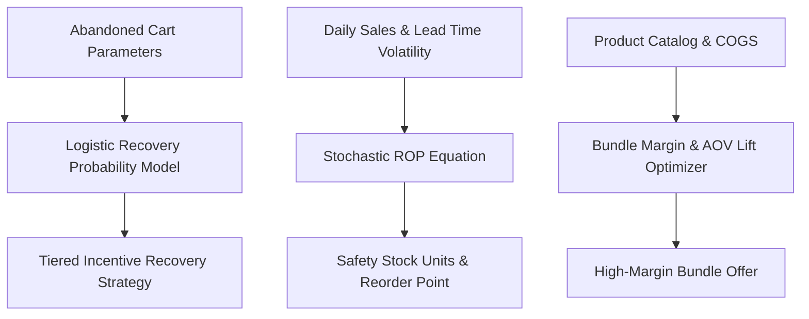

# genpark-accio-shopify-operator


GenPark Accio Shopify Operator is an autonomous DTC e-commerce operations engine implementing logistic cart abandonment recovery modeling, stochastic inventory Reorder Point (ROP) safety stock algorithms, and multi-product tier bundling economics.



## Features
- **Cart Abandonment Predictor**: Calibrated logistic model determining customer recovery likelihood and optimal intervention discounts.
- **Stochastic Inventory ROP**: Formulates exact safety stock accounting for joint demand and lead-time volatility.
- **Tier Bundling Optimizer**: Analyzes multi-product bundles to maximize gross profit and increase Average Order Value (AOV).

## MCP Runtime Requirements

Use Python 3.10+ for the MCP server. The core `client.py` has no external dependencies; MCP transport requires `mcp>=1.0.0,<2`. From this checkout, install it into the Python environment used by your MCP client:

```bash
python -m pip install -r requirements.txt
```

Use the same Python interpreter to launch `mcp_server.py`. In desktop client configuration, set `command` to that interpreter's absolute path.

## Quickstart

```python
from client import GenParkAccioShopifyOperator

shopify = GenParkAccioShopifyOperator()
res = shopify.calculate_inventory_reorder_point_and_rop(30.0, 10.0)
print("Reorder Point Units:", res["reorder_point_units"])
```

## Local MCP Server

After installing the MCP requirements, launch the local STDIO server:

```bash
python mcp_server.py
```

Point your MCP client at the absolute path to `mcp_server.py` using the same Python interpreter. This repository does not provide a hosted MCP endpoint.

## License
MIT
